# Database ERD

PostgreSQL UUID primary keys, NUMERIC(18,2) money, NUMERIC(18,3) quantities, DATE business dates and TIMESTAMPTZ events. All 29 tables include created_at and updated_at. Junction tables also have their own UUID IDs and composite uniqueness.

```mermaid
erDiagram
    departments {
        UUID id PK
        string(30) code
    }
    users {
        UUID id PK
        UUID department_id FK
    }
    roles {
        UUID id PK
        string(50) code
    }
    permissions {
        UUID id PK
        string(100) code
    }
    user_roles {
        UUID id PK
        UUID user_id FK
        UUID role_id FK
    }
    role_permissions {
        UUID id PK
        UUID role_id FK
        UUID permission_id FK
    }
    categories {
        UUID id PK
        string(30) code
        UUID parent_id FK
    }
    products {
        UUID id PK
        string(50) sku
        UUID category_id FK
    }
    suppliers {
        UUID id PK
        string(30) code
    }
    customers {
        UUID id PK
        string(30) code
    }
    warehouses {
        UUID id PK
        string(30) code
    }
    user_warehouses {
        UUID id PK
        UUID user_id FK
        UUID warehouse_id FK
    }
    purchase_orders {
        UUID id PK
        UUID supplier_id FK
        UUID warehouse_id FK
        string(30) status
        decimal(18_2) total_amount
        UUID created_by FK
        UUID approved_by FK
    }
    purchase_order_items {
        UUID id PK
        UUID purchase_order_id FK
        UUID product_id FK
    }
    goods_receipts {
        UUID id PK
        UUID warehouse_id FK
        string(30) status
        UUID received_by FK
    }
    goods_receipt_items {
        UUID id PK
        UUID goods_receipt_id FK
        UUID purchase_order_item_id FK
    }
    inventory_balances {
        UUID id PK
        UUID product_id FK
        UUID warehouse_id FK
        decimal(18_3) quantity_on_hand
        decimal(18_3) quantity_reserved
    }
    stock_movements {
        UUID id PK
        UUID product_id FK
        UUID warehouse_id FK
        UUID performed_by FK
    }
    sales_orders {
        UUID id PK
        UUID customer_id FK
        UUID warehouse_id FK
        string(30) status
        decimal(18_2) total_amount
        UUID created_by FK
    }
    sales_order_items {
        UUID id PK
        UUID sales_order_id FK
        UUID product_id FK
    }
    stock_reservations {
        UUID id PK
        UUID sales_order_item_id FK
        UUID warehouse_id FK
        string(20) status
        UUID created_by FK
    }
    shipments {
        UUID id PK
        UUID warehouse_id FK
        string(30) status
        UUID shipped_by FK
    }
    shipment_items {
        UUID id PK
        UUID shipment_id FK
        UUID sales_order_item_id FK
    }
    invoices {
        UUID id PK
        UUID customer_id FK
        UUID supplier_id FK
        string(20) status
        decimal(18_2) total_amount
        decimal(18_2) paid_amount
        UUID created_by FK
    }
    payments {
        UUID id PK
        UUID invoice_id FK
        string(20) status
        UUID created_by FK
    }
    approval_requests {
        UUID id PK
        UUID requested_by FK
        UUID approver_id FK
        string(20) status
    }
    audit_logs {
        UUID id PK
        UUID actor_id FK
    }
    idempotency_records {
        UUID id PK
        UUID actor_id FK
        string(20) status
    }
    document_sequences {
        UUID id PK
    }
    departments ||--o{ users : "department_id"
    users ||--o{ user_roles : "user_id"
    roles ||--o{ user_roles : "role_id"
    roles ||--o{ role_permissions : "role_id"
    permissions ||--o{ role_permissions : "permission_id"
    categories ||--o{ categories : "parent_id"
    categories ||--o{ products : "category_id"
    users ||--o{ user_warehouses : "user_id"
    warehouses ||--o{ user_warehouses : "warehouse_id"
    suppliers ||--o{ purchase_orders : "supplier_id"
    warehouses ||--o{ purchase_orders : "warehouse_id"
    users ||--o{ purchase_orders : "created_by"
    users ||--o{ purchase_orders : "approved_by"
    purchase_orders ||--o{ purchase_order_items : "purchase_order_id"
    products ||--o{ purchase_order_items : "product_id"
    warehouses ||--o{ goods_receipts : "warehouse_id"
    users ||--o{ goods_receipts : "received_by"
    purchase_orders ||--o{ goods_receipts : "purchase_order_id, warehouse_id"
    goods_receipts ||--o{ goods_receipt_items : "goods_receipt_id"
    purchase_order_items ||--o{ goods_receipt_items : "purchase_order_item_id"
    products ||--o{ inventory_balances : "product_id"
    warehouses ||--o{ inventory_balances : "warehouse_id"
    products ||--o{ stock_movements : "product_id"
    warehouses ||--o{ stock_movements : "warehouse_id"
    users ||--o{ stock_movements : "performed_by"
    customers ||--o{ sales_orders : "customer_id"
    warehouses ||--o{ sales_orders : "warehouse_id"
    users ||--o{ sales_orders : "created_by"
    sales_orders ||--o{ sales_order_items : "sales_order_id"
    products ||--o{ sales_order_items : "product_id"
    sales_order_items ||--o{ stock_reservations : "sales_order_item_id"
    warehouses ||--o{ stock_reservations : "warehouse_id"
    users ||--o{ stock_reservations : "created_by"
    warehouses ||--o{ shipments : "warehouse_id"
    users ||--o{ shipments : "shipped_by"
    sales_orders ||--o{ shipments : "sales_order_id, warehouse_id"
    shipments ||--o{ shipment_items : "shipment_id"
    sales_order_items ||--o{ shipment_items : "sales_order_item_id"
    customers ||--o{ invoices : "customer_id"
    suppliers ||--o{ invoices : "supplier_id"
    users ||--o{ invoices : "created_by"
    sales_orders ||--o{ invoices : "sales_order_id, customer_id"
    purchase_orders ||--o{ invoices : "purchase_order_id, supplier_id"
    invoices ||--o{ payments : "invoice_id"
    users ||--o{ payments : "created_by"
    users ||--o{ approval_requests : "requested_by"
    users ||--o{ approval_requests : "approver_id"
    users ||--o{ audit_logs : "actor_id"
    users ||--o{ idempotency_records : "actor_id"
```

## Integrity decisions

- Concrete FKs use constraints. Receipt/shipment composite FKs enforce the source order warehouse. Invoice composite FKs and CHECK constraints enforce AR/customer/SO versus AP/supplier/PO pairing. One invoice per source order is unique even when other nullable references are absent.
- Balances are unique per product/warehouse; reserved cannot exceed on hand. Order-line and header calculations are checked. Quantity and money checks reject NaN as well as invalid negative/zero values.
- Stock movements and audit logs reject UPDATE, DELETE and TRUNCATE through triggers. The production runtime role is also denied mutation privileges on these immutable tables.
- Services validate stock movement, approval and audit references within the source document transaction because these references can point to different tables.
- Cumulative receiving/shipping, reservation availability, payment aggregates and lifecycle transitions are enforced by services under parent/balance/invoice locks. Row CHECK constraints alone cannot enforce aggregates across multiple documents.
- Schema migrations use a separate infrastructure metadata table, schema_migrations, with version, filename, checksum and applied_at. It is not an extra ERP business table.
- Inventory balances and invoice paid amounts are operational caches. Services update them atomically with immutable movements or posted payments. Reports never mutate these caches.
- updated_at is maintained by repositories on mutable records. Immutable tables retain their insertion timestamps.

## Migration files

The initial up/down pair creates/drops the schema in dependency order. Migration 000002 adds the stock history index `(warehouse_id, product_id, occurred_at DESC, id DESC)` without rebuilding existing tables. The SQL constraint suite rolls back its fixtures, tests rejection cases and verifies the representative history query uses this index without an additional sort.
